I build thoughtful web experiences and enjoy learning how to make software more useful, reliable, and secure.

---

## `> about`

- 🌍 Based in Rwanda
- 💻 Full-stack web development
- 🌱 Exploring cybersecurity and system design
- 🤝 Open to remote opportunities, freelance work, and collaboration

## `> stack`

  

## `> stats`

  
  

  

## `> activity`

  
   
  

---

[Portfolio](https://nzizaa.vercel.app) · [LinkedIn](https://www.linkedin.com/in/nziza-alain-gasasira-03404424b) · [X](https://x.com/AlainGasasira) · [Email](mailto:nziza031@gmail.com)

